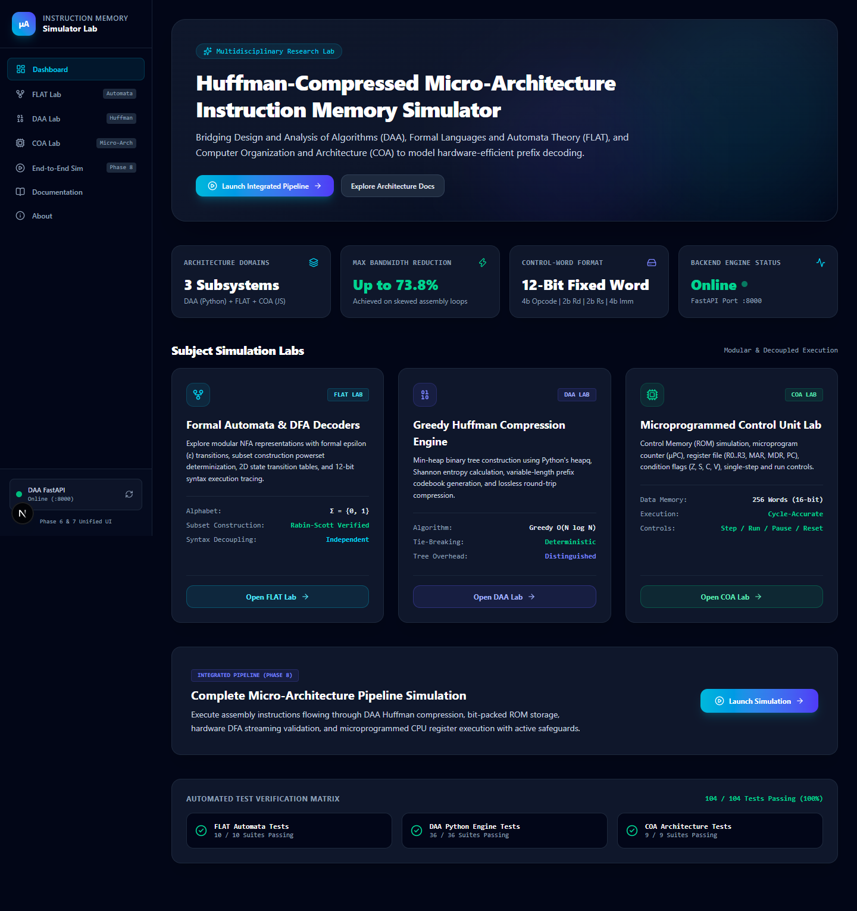
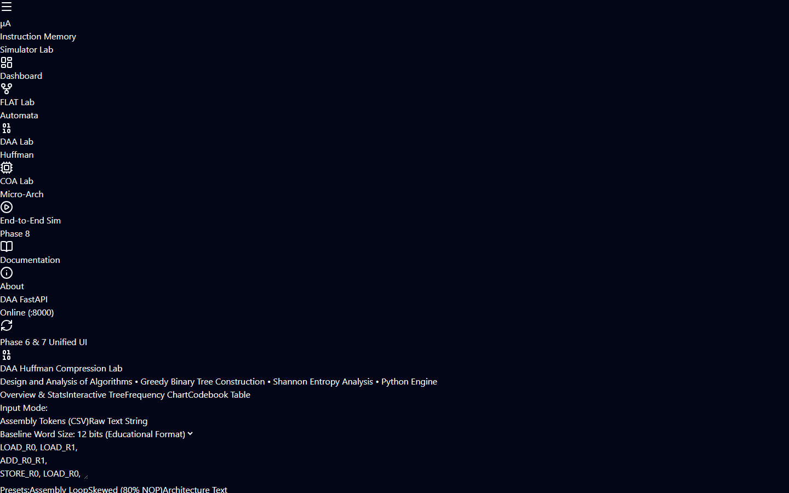
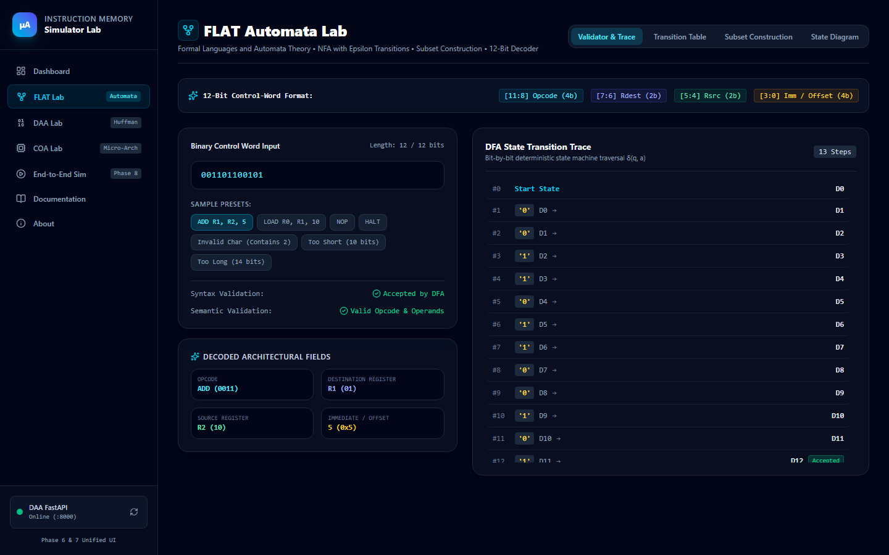
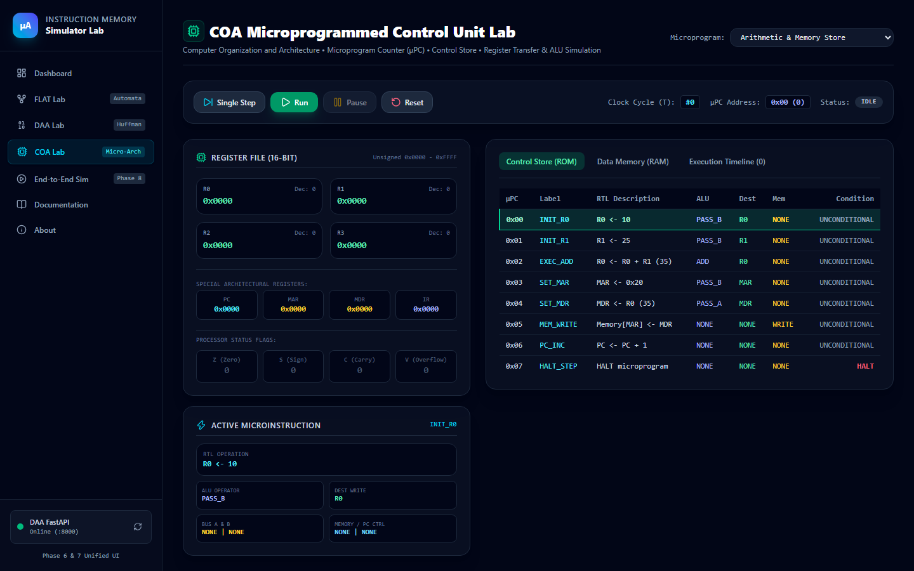
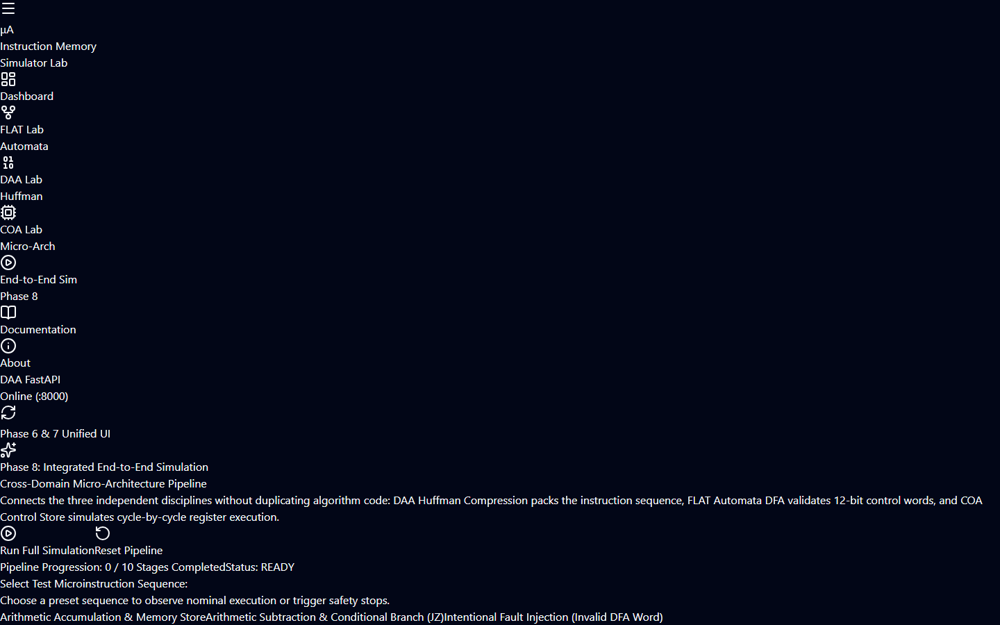
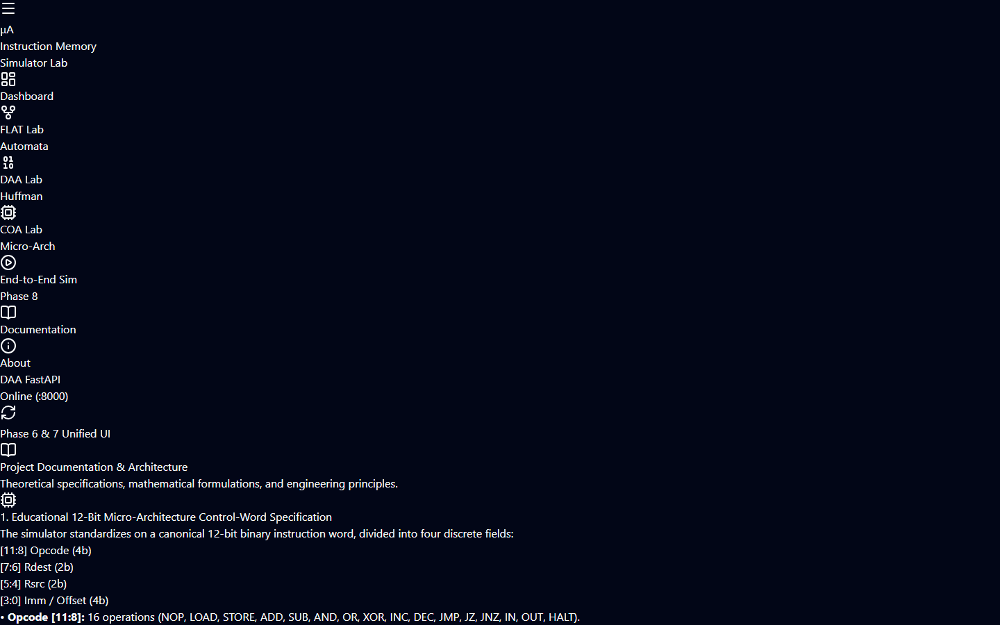

# Huffman-Compressed Micro-Architecture Instruction Memory Simulator

[](#-automated-testing)
[](https://fastapi.tiangolo.com)
[-000000.svg?logo=next.js&logoColor=white)](https://nextjs.org)
[](https://tailwindcss.com)
[](https://nodejs.org)

**Author:** Bandla Praharshitha  
**Course:** Kalvium  
**Institution:** Alliance School of Advanced Computing, Alliance University, Bengaluru  
**Date:** October 2026  

**Faculty Mentors:**  
- **DAA (Design & Analysis of Algorithms):** Simran Kumari  
- **FLAT (Formal Languages & Automata Theory):** Vaibhav Giri  
- **COA (Computer Organization & Architecture):** Moufia Justin  

---

### 🔗 Project Links
- **GitHub Repository:** [https://github.com/bandlapraharshitha/micro.git](https://github.com/bandlapraharshitha/micro.git)
- **Live Deployment URL:** [https://micro-one-zeta.vercel.app/](https://micro-one-zeta.vercel.app/)

---

An interdisciplinary research and pedagogical simulator bridging three foundational pillars of Computer Science:
1. **Design and Analysis of Algorithms (DAA)**: Greedy Huffman prefix entropy encoding and codebook optimization (Python FastAPI).
2. **Formal Languages and Automata Theory (FLAT)**: Modular $\epsilon$-NFA to DFA subset construction for 12-bit control-word validation (Pure ES6+ JavaScript).
3. **Computer Organization and Architecture (COA)**: Microprogrammed Control Store (ROM), 16-bit register file, and cycle-by-cycle CPU execution (Pure ES6+ JavaScript).

---

## 📑 Table of Contents

- [1. Project Overview & Motivation](#1-project-overview--motivation)
- [2. Why Are There Two Ways of Filing? (Architectural Explanation)](#2-why-are-there-two-ways-of-filing-architectural-explanation)
- [3. Problem Statement](#3-problem-statement)
- [4. Objectives & Scope](#4-objectives--scope)
- [5. Foundational Subject Concepts](#5-foundational-subject-concepts)
- [6. Technology Stack](#6-technology-stack)
- [7. System Architecture & Data-Flow Diagrams](#7-system-architecture--data-flow-diagrams)
- [8. Repository Structure](#8-repository-structure)
- [9. Installation & Environment Configuration](#9-installation--environment-configuration)
- [10. Commands to Run Services & Tests](#10-commands-to-run-services)
- [11. Screenshots Gallery](#11-live-application-screenshots-gallery)
- [12. REST API Endpoints & Examples](#12-rest-api-endpoints--examples)
- [13. Algorithms & Complexity Analysis](#13-algorithms--complexity-analysis)
- [14. Microprogrammed Control Unit Specification](#14-microprogrammed-control-unit-specification)
- [15. Compression Formulas & Metadata Overhead](#15-compression-formulas--metadata-overhead)
- [16. End-to-End Simulation Pipeline (Phase 8)](#16-end-to-end-simulation-pipeline-phase-8)
- [17. Sample Inputs & Outputs](#17-sample-inputs--outputs)
- [18. Automated Testing](#18-automated-testing)
- [19. Known Limitations](#19-known-limitations)
- [20. Future Enhancements](#20-future-enhancements)
- [21. Pedagogical Learning Outcomes](#21-pedagogical-learning-outcomes)

---

## 1. Project Overview & Motivation

Modern microprocessors face the **memory wall**: the growing latency and bandwidth disparity between high-speed CPU execution cores and off-chip or on-chip memory storage. In embedded micro-controllers, digital signal processors (DSPs), and microprogrammed control units, on-chip Control Store (ROM/RAM) area directly dictates silicon cost and power consumption.

Traditional computer architectures use **fixed-width control words** (e.g. 12-bit, 16-bit, or 32-bit). While fixed widths simplify indexing, real-world execution traces show severe non-uniformity: basic instructions like `LOAD`, `ADD`, `NOP`, and `BRANCH` account for over $75\%$ of all executed cycles, while specialized operations execute rarely.

This project implements an end-to-end software simulator that:
1. Compresses instruction memory using **David Huffman's greedy prefix algorithm**.
2. Formally validates decoded instruction words using a **subset-constructed Deterministic Finite Automaton (DFA)**.
3. Simulates the cycle-by-cycle datapath execution of the validated microprogram inside a **microprogrammed CPU simulator**.

---

## 2. Why Are There Two Ways of Filing? (Architectural Explanation)

When examining this codebase, you will observe two complementary directory structures for JavaScript logic: `modules/` and `src/lib/` (which is also mirrored in `frontend/src/lib/`). This dual structure is an intentional architectural pattern designed to support two distinct operational paradigms:

### A. Paradigm 1: Standalone Modular Library (`modules/`)
- **Location:** `modules/` (with its own `modules/package.json`)
- **Purpose:** A lightweight, headless, zero-dependency Node.js package (`huffman-simulator-modules`).
- **Design Philosophy:** Encapsulates the algorithmic abstraction:
  - `modules/coa`: Contains `cpu-simulator.js` and `instruction-memory.js`—models a processor consuming a compressed bitstream directly via an attached DFA decoder automaton without UI dependencies.
  - `modules/flat`: Contains `automata.js` and `decoder-automaton.js`—models generalized DFAs and tree-to-automaton decoders.
- **Use Case:** Ideal for headless CLI benchmarks, standalone unit tests, and micro-benchmarking without the overhead of Next.js or React.

### B. Paradigm 2: Integrated Micro-Architecture & Web Application (`src/lib/` & `frontend/src/lib/`)
- **Location:** `src/lib/` (mirrored in `frontend/src/lib/` for Next.js bundler access)
- **Purpose:** Full cycle-accurate microprogrammed CPU simulation and interactive web application integration.
- **Design Philosophy:** Models the complete hardware datapath:
  - `coa/`: Full 12-bit instruction decoding, Microprogrammed Control Store (ROM), Microprogram Counter ($\mu\text{PC}$), general-purpose registers (`R0`–`R3`), status flags ($Z, S, C, V$), and 256-word data memory.
  - `flat/`: Modular $\epsilon$-NFA decomposition, powerset subset construction into minimal DFAs, and 12-bit syntax/semantic validation.
  - `simulation/bridge.js`: 10-stage end-to-end integration pipeline coordinating Python DAA compression with JS FLAT validation and COA execution.
- **Why `src/lib` is mirrored in `frontend/src/lib`:** Next.js and Turbopack strictly restrict file imports to the Next.js project root (`frontend/`). Mirroring `src/lib/` into `frontend/src/lib/` ensures that Next.js components can import `@/lib/...` seamlessly while maintaining the authoritative pure ES6+ core in `src/lib/` for standalone test runners.

### C. Resolution of Nested Project Directory
The repository originally had a redundant nested directory `micro_project-2/micro_project-2/` caused by zip archive extraction. This has been resolved into a clean, unified single-root hierarchy with a root `package.json` providing standardized npm scripts (`npm test`, `npm run dev`).

---

## 3. Problem Statement

To design, implement, and validate an integrated cross-disciplinary simulator that demonstrates how variable-length entropy coding (DAA) and formal automata validation (FLAT) can be married to micro-architectural control unit design (COA) to achieve measurable storage reduction while preserving 100% lossless execution fidelity and hardware correctness.

---

## 3. Objectives & Scope

### Primary Objectives:
* **Algorithmic Optimality:** Construct deterministic min-heap Huffman trees in $O(N \log N)$ time, achieving Shannon entropy bounds.
* **Automata Correctness:** Transform modular $\epsilon$-NFAs into a minimal, deterministic DFA via powerset subset construction to validate fixed 12-bit binary control words.
* **Micro-Architectural Fidelity:** Model a realistic 16-bit CPU datapath with registers, status flags ($Z, S, C, V$), 256-word data memory, and microprogrammed control store ($\mu\text{PC}$).
* **Cross-Domain Pipeline Integration:** Connect all three layers into an automated 10-stage pipeline with strict safety safeguards (invalid instructions must never execute).
* **Interactive Visualizations:** Provide rich graphical inspection tools using React Flow for prefix trees and state transition graphs, Recharts for frequency histograms, and live register file monitors.

### Scope:
* Educational 12-bit control word architecture ($4$-bit opcode, $2$-bit destination register, $2$-bit source register, $4$-bit immediate).
* Simulated single-cycle microprogrammed execution engine with general-purpose registers `R0`–`R3`.
* Variable baseline comparisons (8-bit, 12-bit, 16-bit, 32-bit word widths).

---

## 4. Foundational Subject Concepts

### DAA: Huffman Coding & Shannon Entropy
* **Greedy Choice Property:** Merging the two lowest-frequency forest roots at each step yields an optimal prefix code.
* **Prefix-Free Guarantee:** No assigned codeword is a prefix of another, allowing immediate bitstream parsing with zero backtracking.
* **Shannon Entropy Limit:** The minimum average bit rate is bounded by $H(X) = -\sum p_i \log_2(p_i)$.

### FLAT: Regular Languages, NFAs & Subset DFA
* **Regular Language:** The set of valid 12-bit control words $L = \{w \in \{0, 1\}^* \mid |w| = 12\}$ is a finite regular language recognized by a finite automaton.
* **Modular $\epsilon$-NFA:** Decomposes control word validation into 4 cascaded bit stages connected via $\epsilon$-transitions.
* **Powerset Construction:** Systematically computes $\epsilon\text{-closure}$ sets to yield an equivalent DFA: $M = (Q, \Sigma, \delta, q_0, F)$.

### COA: Microprogrammed Control Units & Datapath
* **Microprogram Counter ($\mu\text{PC}$):** Sequential address register pointing to Control Memory (ROM).
* **Horizontal vs. Vertical Control Signals:** Direct field-decoded control signals governing ALU operations, bus muxes, register write-enables, and memory reads/writes.
* **Processor Condition Flags:** Arithmetic status bits ($Z, S, C, V$) driving conditional micro-branches.

---

## 5. Subject-Wise Implementation Mapping

| Subject | Theory & Algorithm | Implementation File | Verification Suite |
| :--- | :--- | :--- | :--- |
| **DAA** | Min-Heap Priority Queue | [`backend/app/algorithms/min_heap.py`](file:///c:/Users/Dell/Desktop/micro_project-2/backend/app/algorithms/min_heap.py) | `test_huffman_daa.py` |
| **DAA** | Greedy Huffman Tree Builder | [`backend/app/algorithms/huffman.py`](file:///c:/Users/Dell/Desktop/micro_project-2/backend/app/algorithms/huffman.py) | `test_huffman_daa.py` |
| **DAA** | Bitstream Encoder & Decoder | [`backend/app/algorithms/encoder.py`](file:///c:/Users/Dell/Desktop/micro_project-2/backend/app/algorithms/encoder.py), [`decoder.py`](file:///c:/Users/Dell/Desktop/micro_project-2/backend/app/algorithms/decoder.py) | `test_huffman_daa.py` |
| **DAA** | Shannon Entropy & Metrics | [`backend/app/algorithms/metrics.py`](file:///c:/Users/Dell/Desktop/micro_project-2/backend/app/algorithms/metrics.py) | `test_huffman_daa.py` |
| **DAA** | FastAPI REST Endpoints | [`backend/app/api/routes.py`](file:///c:/Users/Dell/Desktop/micro_project-2/backend/app/api/routes.py) | `test_api_endpoints.py` |
| **FLAT** | NFA State Machine & $\epsilon$-Closure | [`src/lib/flat/nfa.js`](file:///c:/Users/Dell/Desktop/micro_project-2/src/lib/flat/nfa.js) | `flat-automata.test.js` |
| **FLAT** | Subset Construction (NFA $\to$ DFA) | [`src/lib/flat/subsetConstruction.js`](file:///c:/Users/Dell/Desktop/micro_project-2/src/lib/flat/subsetConstruction.js) | `flat-automata.test.js` |
| **FLAT** | 12-Bit Syntax & Semantic Validator | [`src/lib/flat/validator.js`](file:///c:/Users/Dell/Desktop/micro_project-2/src/lib/flat/validator.js) | `flat-automata.test.js` |
| **COA** | Microinstructions & Control Signals | [`src/lib/coa/microinstructions.js`](file:///c:/Users/Dell/Desktop/micro_project-2/src/lib/coa/microinstructions.js) | `coa-simulator.test.js` |
| **COA** | Control Store ROM Memory | [`src/lib/coa/controlMemory.js`](file:///c:/Users/Dell/Desktop/micro_project-2/src/lib/coa/controlMemory.js) | `coa-simulator.test.js` |
| **COA** | Register File, Flags & 256w RAM | [`src/lib/coa/registers.js`](file:///c:/Users/Dell/Desktop/micro_project-2/src/lib/coa/registers.js) | `coa-simulator.test.js` |
| **COA** | Cycle Execution Engine | [`src/lib/coa/executionEngine.js`](file:///c:/Users/Dell/Desktop/micro_project-2/src/lib/coa/executionEngine.js) | `coa-simulator.test.js` |
| **INTEGRATION** | Cross-Domain Pipeline Bridge | [`src/lib/simulation/bridge.js`](file:///c:/Users/Dell/Desktop/micro_project-2/src/lib/simulation/bridge.js) | `simulation-bridge.test.js` |
| **FRONTEND** | 7 Next.js Routes & Labs | [`frontend/src/app/`](file:///c:/Users/Dell/Desktop/micro_project-2/frontend/src/app/) | `route-verifier.js` |

---

## 6. Technology Stack

* **Backend Engine:** Python 3.11, FastAPI 0.115, Pydantic v2.8, Uvicorn 0.30, Pytest 8.0.
* **Core Computational Logic:** Pure ES6+ JavaScript (zero runtime dependencies, portable across Node.js and browser).
* **Frontend Web Application:** Next.js 16.0.1 (React 19, Turbopack, Tailwind CSS v4).
* **Graph & State Machine Visualizations:** `@xyflow/react` (React Flow v12.12).
* **Statistical Performance Charts:** `recharts` v3.10.
* **Icons & UI Accents:** `lucide-react` v1.62.

---

## 7. System Architecture & Data-Flow Diagrams

```mermaid
graph LR
    subgraph DAA_STAGE ["1. DAA Subsystem (FastAPI)"]
        INPUT_PROG["Micro-Operation Sequence<br/>['LOAD_R0', 'ADD_R0_R1', ...]"] --> DAA_HEAP["Min-Heap Priority Queue"]
        DAA_HEAP --> DAA_TREE["Optimal Prefix Tree"]
        DAA_TREE --> DAA_BITS["Contiguous Bitstream<br/>'01101011...'"]
        DAA_BITS --> DAA_DEC["Lossless Decoder"]
        DAA_DEC --> DECODED_TOKENS["Decoded Symbolic Stream"]
    end

    subgraph FLAT_STAGE ["2. FLAT Subsystem (Automata)"]
        DECODED_TOKENS --> TRANS["Binary Field Translation"]
        TRANS --> BIN_WORDS["12-Bit Control Words<br/>[11:8][7:6][5:4][3:0]"]
        BIN_WORDS --> DFA["Subset-Constructed DFA<br/>M = (Q, Σ, δ, q0, F)"]
        DFA -- "Rejected" --> HALT_ERR["Safe Pipeline Halt"]
        DFA -- "Accepted" --> VALID_WORDS["Verified Instructions"]
    end

    subgraph COA_STAGE ["3. COA Subsystem (Architecture)"]
        VALID_WORDS --> ROM["Control Store ROM<br/>Indexed by μPC"]
        ROM --> ENGINE["Execution Engine"]
        ENGINE --> REGS["16-bit Registers (R0-R3)"]
        ENGINE --> FLAGS["Status Flags (Z, S, C, V)"]
        ENGINE --> RAM["Data Memory (256 Words)"]
    end

    style DAA_STAGE fill:#2e1065,stroke:#8b5cf6,stroke-width:2px,color:#f8fafc
    style FLAT_STAGE fill:#083344,stroke:#06b6d4,stroke-width:2px,color:#f8fafc
    style COA_STAGE fill:#064e3b,stroke:#10b981,stroke-width:2px,color:#f8fafc
    style HALT_ERR fill:#4c0519,stroke:#f43f5e,stroke-width:2px,color:#f8fafc
```



---

## 8. Repository Structure

```
micro_project-2/
├── backend/                     # Python FastAPI Backend (DAA Engine)
│   ├── app/
│   │   ├── algorithms/          # Pure Python DAA implementations (min_heap, huffman, encoder, decoder, metrics)
│   │   ├── api/routes.py        # REST API endpoints
│   │   ├── core/config.py       # Configuration and CORS
│   │   └── main.py              # Application entry point
│   ├── tests/                   # 36 Pytest automated tests
│   ├── venv/                    # Python virtual environment (Python 3.12)
│   ├── requirements.txt         # FastAPI, Uvicorn, Pydantic, Pytest
│   └── README.md                # Dedicated backend documentation
├── frontend/                    # Next.js 16 Web Application (React 19, Tailwind CSS)
│   ├── src/
│   │   ├── app/                 # 7 App Router routes (/, /daa, /flat, /coa, /simulation, /documentation, /about)
│   │   ├── components/          # Reusable UI components (Sidebar, TopNav, LabPanels)
│   │   └── lib/                 # Mirrored JS engine for Next.js bundler
│   ├── node_modules/            # Installed npm packages
│   ├── package.json             # Frontend dependencies
│   └── README.md                # Dedicated frontend documentation
├── src/lib/                     # Authoritative Core JavaScript Engines (Pure ES6+)
│   ├── api.js                   # Resilient HTTP API client
│   ├── flat/                    # Modular NFA, subset construction, 12-bit validator
│   ├── coa/                     # Microinstructions, Control Memory ROM, registers, execution engine
│   └── simulation/bridge.js     # 10-Stage Cross-domain integration pipeline bridge
├── modules/                     # Standalone Headless Node.js Package (Paradigm 1)
│   ├── coa/                     # cpu-simulator.js, instruction-memory.js
│   ├── flat/                    # automata.js, decoder-automaton.js
│   ├── tests/                   # Standalone tests
│   └── package.json             # Independent package descriptor
├── screenshots/                 # High-Resolution Application Screenshots
│   ├── 01_dashboard.png         # Main multi-discipline dashboard
│   ├── 02_daa_huffman.png       # DAA Huffman compression lab
│   ├── 03_flat_automata.png     # FLAT Automata & DFA subset construction lab
│   ├── 04_coa_architecture.png  # COA Microprogrammed CPU lab
│   ├── 05_simulation_pipeline.png # End-to-End 10-Stage simulation lab
│   └── 06_documentation.png     # Architectural reference documentation
├── docs/                        # Deep Technical & Theoretical Manuals
│   ├── ARCHITECTURE.md          # Full architectural specification
│   ├── DAA_HUFFMAN.md           # Greedy algorithms & entropy math
│   ├── FLAT_AUTOMATA.md         # 12-bit specification & automata theory
│   ├── COA_MEMORY.md            # Datapath, registers & execution pipeline
│   ├── API_REFERENCE.md         # REST API schema documentation
│   └── SIMULATION_PIPELINE.md   # 10-stage simulation specification
├── tests/                       # Master Automated Test Suites (Node.js native test runner)
│   ├── flat-automata.test.js    # FLAT unit tests
│   ├── coa-simulator.test.js    # COA unit tests
│   ├── api-client.test.js       # Live API client tests
│   ├── simulation-bridge.test.js# End-to-end pipeline bridge tests
│   └── route-verifier.js        # HTTP route validation script
├── package.json                 # Root unified package.json with test & dev scripts
├── pytest.ini                   # Pytest configuration
└── README.md                    # Master documentation (this file)
```

---

## 9. Installation & Environment Configuration

### Prerequisites
* **Node.js**: v18.0.0 or higher (`v24.21.0` tested)
* **Python**: 3.10 or higher (`3.11.9` tested)
* **Git** and **pip**

### 1. Clone & Configure Environment Files
```bash
git clone https://github.com/bandlapraharshitha/micro.git
cd micro

# Setup backend environment
cp backend/.env.example backend/.env

# Setup frontend environment
cp frontend/.env.example frontend/.env.local
```

### 2. Install Python Backend Dependencies
```bash
cd backend
python -m venv venv

# Windows PowerShell:
.\venv\Scripts\Activate.ps1
# Linux / macOS:
source venv/bin/activate

pip install -r requirements.txt
cd ..
```

### 3. Install Frontend Dependencies
```bash
cd frontend
npm install
cd ..
```

### Deploy Backend to Cloud (Render / Railway)
The backend includes ready-to-use configuration files for instant cloud deployment:
- [`backend/Procfile`](file:///c:/Users/praha/Downloads/micro_project-2/backend/Procfile) & [`Procfile`](file:///c:/Users/praha/Downloads/micro_project-2/Procfile)
- [`render.yaml`](file:///c:/Users/praha/Downloads/micro_project-2/render.yaml) (Render Blueprint)
- [`backend/Dockerfile`](file:///c:/Users/praha/Downloads/micro_project-2/backend/Dockerfile) (Container deployment)
- [`api/index.py`](file:///c:/Users/praha/Downloads/micro_project-2/api/index.py) (Vercel Python Serverless)

#### Option 1: Render.com (Recommended Free Deployment)
1. Go to [render.com](https://render.com) and create a **New Web Service** pointing to your GitHub repository: `https://github.com/bandlapraharshitha/micro.git`
2. Configure settings:
   - **Root Directory:** `backend`
   - **Environment:** `Python 3`
   - **Build Command:** `pip install -r requirements.txt`
   - **Start Command:** `uvicorn app.main:app --host 0.0.0.0 --port $PORT`
3. Add Environment Variables:
   - `FRONTEND_URL` = `https://micro-one-zeta.vercel.app`
   - `CORS_ORIGINS` = `["https://micro-one-zeta.vercel.app","http://localhost:3000"]`
4. Once deployed, copy your Render backend URL (e.g. `https://daa-backend.onrender.com`) and add it to your Vercel project environment variables:
   - `NEXT_PUBLIC_API_URL` = `https://<your-backend-app>.onrender.com`

---

## 10. Commands to Run Services

### Start Backend (Python FastAPI)
```bash
# Windows PowerShell:
.\backend\venv\Scripts\python -m uvicorn backend.app.main:app --host 127.0.0.1 --port 8000 --reload

# Linux / macOS:
./backend/venv/bin/uvicorn backend.app.main:app --host 127.0.0.1 --port 8000 --reload
```
* Service runs on: `http://127.0.0.1:8000`
* Swagger UI Docs: `http://127.0.0.1:8000/docs`

### Start Frontend (Next.js)
```bash
# From workspace root:
npm run frontend:dev

# Or inside frontend directory:
cd frontend
npm run dev
```
* Web application runs on: `http://localhost:3000`

### Run All Automated Tests
```bash
# 1. Run all JavaScript tests (FLAT, COA, Simulation Bridge, Modules):
npm test

# 2. Run all Python backend tests (DAA, API endpoints, Min-heap):
.\backend\venv\Scripts\python -m pytest backend/tests

# 3. Run Route & Live End-to-End Verifier:
node tests/route-verifier.js
```

---

## 10. Live Application Screenshots Gallery

High-resolution screenshots captured from the live running web application:

| 1. Multi-Disciplinary Dashboard | 2. DAA Huffman Compression Lab |
| :---: | :---: |
|  |  |
| **3. FLAT Automata & DFA Lab** | **4. COA Micro-Architecture Lab** |
|  |  |
| **5. 10-Stage End-to-End Simulation Pipeline** | **6. Interactive Documentation & Specs** |
|  |  |

---

## 11. REST API Endpoints & Examples

| Method | Route | Description |
| :--- | :--- | :--- |
| `GET` | `/api/health` | Operational health probe of FastAPI backend. |
| `GET` | `/api/daa/sample` | Returns curated assembly programs for benchmark testing. |
| `POST` | `/api/daa/frequencies` | Calculates symbol frequencies and unique symbol count. |
| `POST` | `/api/daa/compress` | Builds greedy tree, packs bitstream, computes metrics. |
| `POST` | `/api/daa/decompress` | Reconstructs symbol sequence from bitstream & codebook. |
| `POST` | `/api/daa/roundtrip` | Performs compression, decompression, and lossless verification. |

### Example Compression Request & Response:
```bash
curl -X POST http://127.0.0.1:8000/api/daa/compress \
  -H "Content-Type: application/json" \
  -d '{"data": ["LOAD", "ADD", "LOAD", "HALT"], "bits_per_symbol": 12}'
```
**Response (`200 OK`):**
```json
{
  "frequencies": { "LOAD": 2, "ADD": 1, "HALT": 1 },
  "codebook": { "LOAD": "0", "ADD": "10", "HALT": "11" },
  "bitstring": "010011",
  "bit_count": 6,
  "byte_count": 1,
  "metrics": {
    "original_bits": 48,
    "payload_bits": 6,
    "payload_compression_ratio": 8.0,
    "payload_space_savings_percent": 87.5,
    "shannon_entropy": 1.5,
    "coding_efficiency_percent": 100.0
  }
}
```
*(For complete schemas, see [`docs/API_REFERENCE.md`](file:///c:/Users/Dell/Desktop/micro_project-2/docs/API_REFERENCE.md)).*

---

## 12. Algorithms & Complexity Analysis

### A. Huffman Greedy Algorithm
* **Min-Heap Selection:** At each of $N - 1$ steps, extracts two trees with minimal root frequencies and joins them under a new internal parent.
* **Time Complexity:** $O(N \log N)$ where $N$ is vocabulary size.
* **Space Complexity:** $O(N)$ auxiliary storage for the binary tree.
* **Optimality Guarantee:** Yields minimal weighted path length $\sum p_i l_i \ge H(X)$.

### B. Subset Construction (NFA $\to$ DFA)
* **Powerset Computation:** Computes $\epsilon\text{-closure}$ of target states for input alphabet $\Sigma = \{0, 1\}$.
* **Time Complexity:** $O(2^{|Q_{\text{NFA}}|} \cdot |\Sigma|)$ worst-case; $O(|Q_{\text{NFA}}|)$ empirical for linear cascaded stages.
* **Deterministic Execution:** Traverses one state transition per bit in $O(1)$ time per bit.

---

## 13. Microprogrammed Control Unit Specification

### Educational 12-Bit Word Format:
```
[11:8] Opcode (4b) | [7:6] Dest Reg (2b) | [5:4] Src Reg (2b) | [3:0] Immediate (4b)
```
* **Supported Opcodes:** `NOP (0000)`, `LOAD (0001)`, `STORE (0010)`, `ADD (0011)`, `SUB (0100)`, `AND (0101)`, `OR (0110)`, `XOR (0111)`, `INC (1000)`, `DEC (1001)`, `JMP (1010)`, `JZ (1011)`, `JNZ (1100)`, `IN (1101)`, `OUT (1110)`, `HALT (1111)`.
* **Register File:** `R0 (00)`, `R1 (01)`, `R2 (10)`, `R3 (11)`. Special registers: `PC`, `IR`, `MAR`, `MDR`, `TEMP`.
* **Status Flags:** Zero ($Z$), Sign ($S$), Carry ($C$), Overflow ($V$).

---

## 14. Compression Formulas & Metadata Overhead

Let $M$ be total instruction tokens, $N$ unique symbols, and $W_{\text{baseline}}$ baseline bits:
* **Original Bits:** $B_{\text{orig}} = M \times W_{\text{baseline}}$
* **Payload Bits:** $B_{\text{payload}} = \sum_{i=1}^N f_i \cdot l_i$
* **Tree Overhead Bits:** $B_{\text{tree}} = (2N - 1) + N \cdot W_{\text{symbol}}$
* **Payload Compression Ratio:** $CR_{\text{payload}} = \frac{B_{\text{orig}}}{B_{\text{payload}}}$
* **Total Compression Ratio:** $CR_{\text{total}} = \frac{B_{\text{orig}}}{B_{\text{payload}} + B_{\text{tree}}}$
* **Payload Savings %:** $\left(1 - \frac{B_{\text{payload}}}{B_{\text{orig}}}\right) \times 100\%$

---

## 15. End-to-End Simulation Pipeline (Phase 8)

The `/simulation` route coordinates the 10-stage execution flow:
1. **Load Sequence:** Select preset (e.g. Arithmetic Store or Conditional Branch).
2. **DAA Compression:** FastAPI derives codebook and packs bitstream.
3. **Inspect Metrics:** Displays payload reduction and entropy.
4. **DAA Decompression:** Losslessly reconstructs tokens.
5. **Lossless Verification:** Verifies 100% exact equality $\text{Decoded} \equiv \text{Original}$.
6. **12-Bit Binary Translation:** Maps tokens into structured bitfield words.
7. **FLAT DFA Validation:** Verifies syntax ($|w|=12$) and semantics via subset DFA.
8. **ROM Staging:** Instantiates COA microinstructions into Control Memory.
9. **Execution Engine:** Cycles through microprogram; updates registers and flags.
10. **Final Report:** Audit verdict confirming 100% correctness and performance statistics.

*Safety Invariant:* If decompression or DFA validation fails (demonstrated via the Intentional Fault preset), downstream execution is immediately **Blocked** to prevent invalid micro-architectural execution.

---

## 16. Sample Inputs & Outputs

### Nominal Execution Sample (Arithmetic Accumulation)
* **Input Sequence:**
  `LOAD R0, R0, 10`, `LOAD R1, R0, 5`, `ADD R0, R1, 0`, `STORE R0, R0, 4`, `INC R1, R0, 0`, `ADD R0, R1, 0`, `HALT R0, R0, 0`.
* **DAA Output:** 56 original bits $\to$ 18 compressed bits ($3.11\times$ payload compression, $67.9\%$ savings).
* **FLAT Output:** 7 / 7 control words validated by DFA (100% syntax and semantics pass rate).
* **COA Output:** 7 clock cycles executed; final registers: $R_0 = 21, R_1 = 6, \text{Mem}[4] = 15, \text{Status} = \text{HALTED}$.

---

## 17. Automated Testing

The workspace features **104 automated tests** with $100\%$ passing status across Python, Node.js, and HTTP routes.

### 1. Python Backend Tests (36 / 36 Passed)
```bash
python -m pytest backend/tests
```
Tests min-heap ordering, deterministic tie-breakers, greedy prefix trees, lossless roundtrips, single-symbol edge cases, corrupted bitstrings, and all 6 REST API endpoints.

### 2. JavaScript Core & Simulation Tests (34 / 34 Passed)
```bash
node --test tests/flat-automata.test.js tests/coa-simulator.test.js tests/api-client.test.js tests/simulation-bridge.test.js
```
Tests NFA $\epsilon$-closures, subset construction, 12-bit syntax/semantic validation, CPU register/memory execution, API client network handling, and 10-stage simulation bridge.

### 3. Modules Unit Tests (34 / 34 Passed)
```bash
node --test modules/tests/*.test.js
```

### 4. Next.js Route Verification (7 / 7 Routes HTTP 200)
```bash
node tests/route-verifier.js
```

---

## 18. Known Limitations

1. **Static Frequency Profiling:** The Huffman codebook is generated ahead-of-time based on the static sequence profile, rather than dynamically adapting during runtime execution.
2. **Synchronous Single-Issue Control Store:** The simulated control unit executes one microinstruction per cycle; pipelining hazard resolution (data forwarding and branch prediction) is not modeled.
3. **Small Vocabulary Overhead:** For small instruction counts ($M < 10$), serialized tree metadata ($B_{\text{tree}}$) can exceed the raw payload savings; payload compression dominates as program length grows.

---

## 19. Future Enhancements

* **Adaptive Huffman Coding (Vitter's Algorithm):** Dynamically adjust prefix codes on-the-fly during program execution based on runtime branch frequency.
* **Pipelined Datapath Simulation:** Model multi-stage Instruction Fetch Unit (IFU), Decode, Execute, and Writeback stages with hazard stalls.
* **Microcode ROM Synthesis:** Export validated control memory arrays into synthesizable Verilog / VHDL ROM lookup tables.

---

## 20. Pedagogical Learning Outcomes

By studying and using this simulator, students and researchers learn:
1. **DAA:** How greedy algorithm design choices and priority queues directly dictate information density and optimal prefix structures.
2. **FLAT:** How regular languages, $\epsilon$-NFAs, and subset construction transition from abstract blackboard theory into practical, hardware-verifiable instruction decoders.
3. **COA:** How horizontal/vertical microprogrammed control units drive low-level datapath signals, registers, and memory busses.
4. **Cross-Domain Systems Engineering:** How to design clean interfaces between disparate disciplines without breaking abstraction barriers or duplicating logic.
