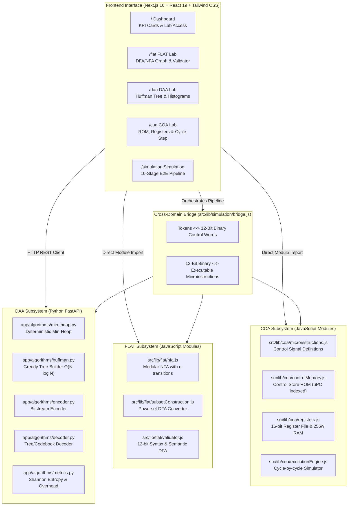

# System Architecture & Technical Specifications

## Huffman-Compressed Micro-Architecture Instruction Memory Simulator

This simulator unifies three fundamental computer science disciplines to study, simulate, and visualize instruction memory compression within modern computer architectures:



---

## 1. Domain Interconnections & Theoretical Foundations

### A. DAA: Design and Analysis of Algorithms
* **Role**: Analytical optimization engine for symbol entropy reduction.
* **Algorithm**: David Huffman's greedy algorithm ($O(N \log N)$), implemented with Python's standard `heapq`.
* **Tie-Breaking Strategy**: Deterministic 3-tuple `(frequency, insertion_order, min_symbol)` to guarantee identical trees across platforms.
* **Metrics**:
  - Empirical probability: $p_i = \frac{f_i}{\sum f_k}$
  - Shannon Entropy: $H(X) = -\sum_{i=1}^n p_i \log_2(p_i)$
  - Average code length: $\bar{L} = \sum_{i=1}^n p_i l_i$
  - Coding efficiency: $\eta = \frac{H(X)}{\bar{L}} \times 100\%$
  - Payload compression ratio: $CR_{\text{payload}} = \frac{\text{Original Bits}}{\text{Payload Bits}}$
  - Total compression ratio: $CR_{\text{total}} = \frac{\text{Original Bits}}{\text{Payload Bits} + \text{Tree Overhead Bits}}$

---

### B. FLAT: Formal Languages and Automata Theory
* **Role**: Formal verification of instruction words and hardware-efficient streaming decompression.
* **12-Bit Micro-Architecture Control-Word Language**:
  $$L = \{w \in \{0, 1\}^* \mid |w| = 12\}$$
  Structured into modular bitfields:
  `[11:8] Opcode (4b)` $\to$ `[7:6] Dest Reg (2b)` $\to$ `[5:4] Src Reg (2b)` $\to$ `[3:0] Immediate (4b)`.
* **Modular NFA with $\epsilon$-Transitions**:
  Four linear sub-stages connected by formal $\epsilon$-transitions:
  $$s_{\text{op\_4}} \xrightarrow{\epsilon} s_{\text{rd\_0}}, \quad s_{\text{rd\_2}} \xrightarrow{\epsilon} s_{\text{rs\_0}}, \quad s_{\text{rs\_2}} \xrightarrow{\epsilon} s_{\text{imm\_0}}$$
* **Subset Construction ($O(2^{|Q|} \cdot |\Sigma|)$)**:
  Systematically translates the modular NFA into an equivalent DFA transition table via $\epsilon\text{-closure}$ powerset exploration.
* **Decoupled Validation**:
  - *Syntax Validation*: Verifies binary alphabet ($\Sigma = \{0, 1\}$), exact 12-bit length, and DFA acceptance.
  - *Semantic Validation*: Decodes binary fields into mnemonic, destination register, source register, and immediate operands, verifying instruction-specific constraints.

---

### C. COA: Computer Organization and Architecture
* **Role**: Microprogrammed control unit and register-transfer execution simulator.
* **Control Memory (ROM)**: High-speed microprogram memory indexed by the microprogram counter ($\mu\text{PC}$).
* **16-Bit Register File**:
  - General Purpose: `R0`, `R1`, `R2`, `R3`
  - Architectural: `PC` (Program Counter), `IR` (Instruction Register)
  - Bus Interface: `MAR` (Memory Address Register), `MDR` (Memory Data Register), `TEMP` (ALU Latch)
* **Status Flags**: Evaluated dynamically after every ALU operation:
  - Zero Flag ($Z$): Set if result $= 0$
  - Sign Flag ($S$): Set if bit 15 $= 1$
  - Carry Flag ($C$): Set if 16-bit unsigned overflow occurs
  - Overflow Flag ($V$): Set if two's-complement signed overflow occurs
* **Simulated Data Memory**: 256-word 16-bit addressable memory space with out-of-bounds guards.
* **Execution Safeguards**: Cycle timeout counter ($1000$ max steps) preventing infinite runaway loops during branch execution.

---

## 2. Directory Layout

```
micro_project-2/
├── .gitignore                   # Multi-language Git ignore definitions
├── .env.example                 # Root environment configuration template
├── README.md                    # Master comprehensive project documentation
├── pytest.ini                   # Pytest test configuration
├── docs/                        # Deep technical & architectural manuals
│   ├── ARCHITECTURE.md          # Full system architecture (this document)
│   ├── DAA_HUFFMAN.md           # Greedy algorithms, Shannon entropy, & codebooks
│   ├── FLAT_AUTOMATA.md         # 12-bit format, NFA, subset construction & DFA
│   ├── COA_MEMORY.md            # Microprogrammed control unit & memory modeling
│   ├── API_REFERENCE.md         # FastAPI REST endpoints reference manual
│   └── SIMULATION_PIPELINE.md   # 10-stage end-to-end integrated simulation guide
├── backend/                     # Python FastAPI Backend (DAA Engine)
│   ├── requirements.txt         # Python dependencies
│   ├── .env.example             # Backend environment template
│   ├── app/
│   │   ├── main.py              # FastAPI application entry & CORS config
│   │   ├── algorithms/          # Pure Python algorithmic modules
│   │   │   ├── min_heap.py      # Custom deterministic min-heap
│   │   │   ├── huffman.py       # Greedy tree construction & code generation
│   │   │   ├── encoder.py       # Contiguous bitstream & byte encoder
│   │   │   ├── decoder.py       # Lossless bitstream decoder
│   │   │   └── metrics.py       # Shannon entropy & compression calculations
│   │   ├── api/
│   │   │   └── routes.py        # Pydantic-validated REST API endpoints
│   │   └── core/
│   │       └── config.py        # Settings management
│   └── tests/                   # Pytest automated test suite (36 tests)
│       ├── test_huffman_daa.py   # Huffman & metrics unit tests
│       ├── test_health.py       # API health check probe test
│       └── test_api_endpoints.py # REST endpoints integration tests
├── src/                         # JavaScript Core Modules (FLAT, COA, Simulation)
│   └── lib/
│       ├── api.js               # Resilient frontend API client
│       ├── flat/                # Automata & 12-bit validator
│       │   ├── nfa.js           # NFA class & epsilon-closure
│       │   ├── subsetConstruction.js # Powerset DFA converter
│       │   └── validator.js     # 12-bit syntax & semantic validator
│       ├── coa/                 # Microprogrammed control unit
│       │   ├── microinstructions.js # Microinstruction format & signals
│       │   ├── controlMemory.js # Control ROM store
│       │   ├── registers.js     # Register file & data memory
│       │   └── executionEngine.js # Cycle-by-cycle simulator
│       └── simulation/
│           └── bridge.js        # Cross-domain bridge (DAA <-> FLAT <-> COA)
├── frontend/                    # Next.js 16 Web Application (React 19, Tailwind CSS)
│   ├── package.json             # Frontend dependencies & npm scripts
│   ├── .env.example             # Frontend environment template
│   ├── src/
│   │   ├── components/
│   │   │   └── Sidebar.js       # Persistent navigation sidebar & health badge
│   │   ├── lib/                 # Re-exported / mirrored algorithms for Next.js
│   │   └── app/                 # Next.js App Router Pages
│   │       ├── layout.js        # Root HTML layout with persistent sidebar
│   │       ├── globals.css      # Tailwind styling & dark scrollbars
│   │       ├── page.js          # / (Dashboard with KPI cards & Lab links)
│   │       ├── flat/page.js     # /flat (FLAT Automata Lab)
│   │       ├── daa/page.js      # /daa (DAA Huffman Lab)
│   │       ├── coa/page.js      # /coa (COA Micro-Architecture Lab)
│   │       ├── simulation/page.js # /simulation (10-Stage Pipeline Simulation)
│   │       ├── documentation/page.js # /documentation (Theoretical Reference)
│   │       └── about/page.js    # /about (Pedagogical Mission & Tech Stack)
├── tests/                       # Root automated test suite (34 tests)
│   ├── flat-automata.test.js    # FLAT automata unit tests
│   ├── coa-simulator.test.js    # COA micro-architecture unit tests
│   ├── api-client.test.js       # API client integration tests
│   ├── simulation-bridge.test.js # E2E simulation bridge tests
│   └── route-verifier.js        # Automated HTTP route verifier script
└── modules/                     # Standalone JS modules & tests (34 tests)
```

---

## 3. Technology Stack

| Layer | Technologies | Justification |
| :--- | :--- | :--- |
| **Backend** | Python 3.11, FastAPI, Pydantic v2, Uvicorn, Pytest | High-performance asynchronous REST API with strict type validation and canonical standard-library greedy `heapq` structures. |
| **Core Algorithms** | Vanilla ES6+ JavaScript, Node.js Test Runner | Zero-dependency, portable, deterministic automata state machine and microprogrammed CPU simulator. |
| **Frontend Web App** | Next.js 16, React 19, Tailwind CSS v4 | Cutting-edge server and client component hybrid framework with utility-first responsive styling. |
| **Graph Visualization** | `@xyflow/react` (React Flow) | Hardware-accelerated interactive canvas for DFA state graphs and hierarchical binary prefix trees. |
| **Analytics Charts** | `recharts` | Responsive SVG bar charts visualizing symbol frequency distribution and Shannon entropy bounds. |
