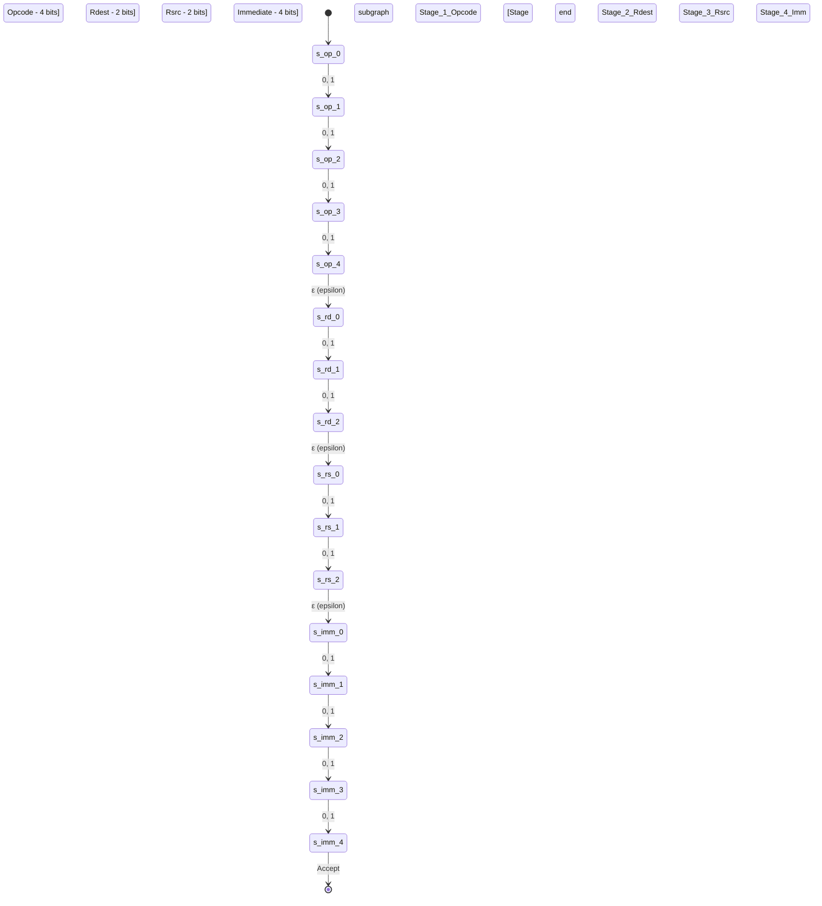
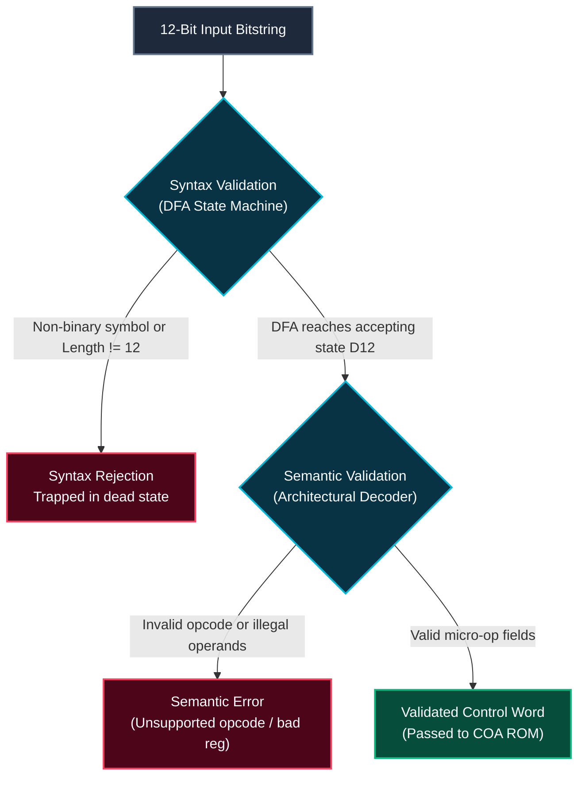

# FLAT: Formal Languages and Automata Theory

## 1. Educational 12-Bit Micro-Architecture Control-Word Specification

In computer architectures, control units operate on structured bitfields that determine ALU operations, bus routing, and storage registers:

```
  Bits:  11  10   9   8  |  7   6  |  5   4  |  3   2   1   0
 Field: [    OPCODE    ] | [ Rdest] | [ Rsrc ] | [  IMMEDIATE  ]
 Width:      4 bits          2 bits     2 bits       4 bits
```

### Complete Bitfield Specifications

#### 1. Opcode Mapping (Bits [11:8], 4 bits)
| Binary Code | Mnemonic | Name | Category | Semantics |
| :--- | :--- | :--- | :--- | :--- |
| `0000` | `NOP` | No Operation | CONTROL | No state update; advances $\mu\text{PC}$. |
| `0001` | `LOAD` | Load Immediate / Memory | MEMORY | $R_{dest} \leftarrow \text{Imm}$ (or $\text{Mem}[\text{MAR}]$). |
| `0010` | `STORE` | Store Register to Memory | MEMORY | $\text{Mem}[\text{MAR}] \leftarrow R_{src}$ (or at offset Imm). |
| `0011` | `ADD` | Add Registers | ALU | $R_{dest} \leftarrow R_{dest} + R_{src}$. Flags: $Z, S, C, V$. |
| `0100` | `SUB` | Subtract Registers | ALU | $R_{dest} \leftarrow R_{dest} - R_{src}$. Flags: $Z, S, C, V$. |
| `0101` | `AND` | Bitwise AND | ALU | $R_{dest} \leftarrow R_{dest} \ \& \ R_{src}$. Flags: $Z, S$. |
| `0110` | `OR` | Bitwise OR | ALU | $R_{dest} \leftarrow R_{dest} \mid R_{src}$. Flags: $Z, S$. |
| `0111` | `XOR` | Bitwise XOR | ALU | $R_{dest} \leftarrow R_{dest} \oplus R_{src}$. Flags: $Z, S$. |
| `1000` | `INC` | Increment Register | ALU | $R_{dest} \leftarrow R_{dest} + 1$. Flags: $Z, S, C, V$. |
| `1001` | `DEC` | Decrement Register | ALU | $R_{dest} \leftarrow R_{dest} - 1$. Flags: $Z, S, C, V$. |
| `1010` | `JMP` | Unconditional Jump | BRANCH | $\mu\text{PC} \leftarrow \text{Imm}$. |
| `1011` | `JZ` | Jump if Zero | BRANCH | If $Z = 1$ then $\mu\text{PC} \leftarrow \text{Imm}$ else $\mu\text{PC}++$. |
| `1100` | `JNZ` | Jump if Not Zero | BRANCH | If $Z = 0$ then $\mu\text{PC} \leftarrow \text{Imm}$ else $\mu\text{PC}++$. |
| `1101` | `IN` | Peripheral Port Read | IO | $R_{dest} \leftarrow \text{Port}[\text{Imm}]$. |
| `1110` | `OUT` | Peripheral Port Write | IO | $\text{Port}[\text{Imm}] \leftarrow R_{dest}$. |
| `1111` | `HALT` | Halt Execution | CONTROL | Asserts clock halt; terminates execution. |

#### 2. Register Allocations (Bits [7:6] $R_{dest}$ and Bits [5:4] $R_{src}$)
| Binary Encoding | Register Name | Width | Type |
| :--- | :--- | :--- | :--- |
| `00` | `R0` | 16-bit | General Purpose Accumulator |
| `01` | `R1` | 16-bit | General Purpose Operand Register |
| `10` | `R2` | 16-bit | General Purpose Index Register |
| `11` | `R3` | 16-bit | General Purpose Base Register |

#### 3. Immediate / Offset (Bits [3:0], 4 bits)
Unsigned 4-bit integer constant representing immediate operands or branch jump targets ($0 \le \text{Imm} \le 15$).

---

## 2. Modular NFA with Epsilon ($\epsilon$) Transitions

The regular language accepting all syntactically valid 12-bit control words is:
$$L = \{w \in \{0, 1\}^* \mid |w| = 12\}$$

Instead of constructing an unstructured 13-state machine, we build four modular sub-automata matching the architectural bitfields, joined via explicit **$\epsilon$-transitions**:



### Formal Epsilon-Closure Definition
For a state set $S \subseteq Q$, the $\epsilon\text{-closure}(S)$ is the set of all states reachable from any state in $S$ via zero or more $\epsilon$-transitions:
$$\epsilon\text{-closure}(S) = S \cup \{q' \in Q \mid \exists q \in \epsilon\text{-closure}(S) \text{ such that } (q, \epsilon, q') \in \Delta\}$$
Our implementation in [`src/lib/flat/nfa.js`](file:///c:/Users/Dell/Desktop/micro_project-2/src/lib/flat/nfa.js) handles cycles and multi-hop paths using a visited set to avoid infinite recursion.

---

## 3. Subset Construction Algorithm (NFA $\to$ DFA)

To execute state transitions deterministically in hardware, we eliminate non-determinism using the **powerset subset construction algorithm**:

```
Algorithm CONVERT-NFA-TO-DFA(NFA)
  q0_dfa = ε-closure({NFA.startState})
  DFA.startState = StateKey(q0_dfa)
  Unprocessed = [ q0_dfa ]
  DFAStates = { StateKey(q0_dfa): q0_dfa }

  while Unprocessed is not empty do
    currentSubset = Unprocessed.POP()
    currentKey = StateKey(currentSubset)

    for each symbol a in Σ do
      moveSet = NFA.move(currentSubset, a)
      targetSubset = ε-closure(moveSet)

      if targetSubset is not empty then
        targetKey = StateKey(targetSubset)
        if targetKey not in DFAStates then
          DFAStates[targetKey] = targetSubset
          Unprocessed.PUSH(targetSubset)
        DFA.addTransition(currentKey, a, targetKey)
        
  for each (dfaKey, subset) in DFAStates do
    if any state in subset is accepting in NFA then
      DFA.markAccepting(dfaKey)

  return DFA
```

### Complexity Analysis
* **Time Complexity:** $O(2^{|Q_{\text{NFA}}|} \cdot |\Sigma|)$ in the theoretical worst case. For our 12-bit linear staged NFA, each stage depth has a unique $\epsilon$-closure, resulting in exactly **13 DFA states** ($D_0$ through $D_{12}$), executing in $O(|Q_{\text{NFA}}|)$ empirical time.
* **Space Complexity:** $O(2^{|Q_{\text{NFA}}|})$ representing the powerset transition table.

---

## 4. Decoupled Syntax vs. Semantic Validation

To maintain rigorous compiler and automata principles, validation is decoupled into two separate operations:



1. **`validateSyntax(bitstring)`**:
   - Traces transitions bit-by-bit through `traceDFA(dfa, bitstring)`.
   - Confirms $|w| = 12$ and final state $\in F_{\text{DFA}}$.
2. **`validateSemantics(bitstring)`**:
   - Slices bits: `opcodeBits = bitstring[0:4]`, `destBits = bitstring[4:6]`, `srcBits = bitstring[6:8]`, `immBits = bitstring[8:12]`.
   - Verifies opcode existence in `OPCODE_MAP`.
   - Checks instruction-specific constraints (e.g. `NOP` and `HALT` operand zeroes, single-operand rules for `INC`/`DEC`).
