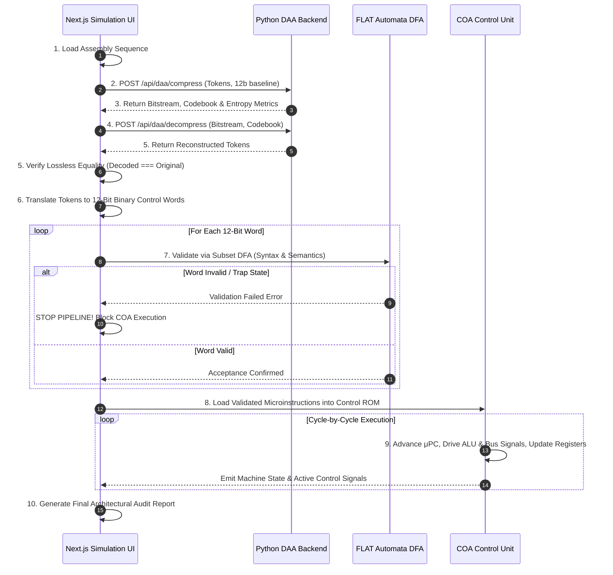

# Integrated Simulation Pipeline (Phase 8 Specification)

The **End-to-End Simulation Pipeline** connects the three independent domains of the project into a continuous architectural workflow without duplicating algorithm code:

1. **DAA (Python FastAPI)**: Greedy entropy coding & variable-length bitstream compression.
2. **FLAT (JavaScript)**: Subset-constructed DFA hardware model for 12-bit control word validation.
3. **COA (JavaScript)**: Microprogrammed Control Store (ROM) and cycle-by-cycle register execution engine.

---

## 🏛️ Pipeline Data-Flow Architecture



---

## 🔍 Conceptual Separation: DAA vs. FLAT

A critical architectural invariant enforced in this simulator is:

> **Do not feed Huffman-encoded bitstreams directly into the control-word DFA.**

### Why This Separation is Essential:
1. **DAA Huffman Coding** operates on **variable-length prefix codes** designed solely to minimize entropy ($H(X)$) and payload transmission bandwidth. It has no semantic understanding of opcodes, destination registers, or immediate operands.
2. **FLAT Control-Word DFA** operates on a **fixed-length regular language** ($L = \{w \in \{0, 1\}^* \mid |w| = 12\}$) with rigid architectural field boundaries:
   - Bits `[11:8]`: Opcode (4 bits)
   - Bits `[7:6]`: Destination Register $R_{dest}$ (2 bits)
   - Bits `[5:4]`: Source Register $R_{src}$ (2 bits)
   - Bits `[3:0]`: Immediate / Branch Target (4 bits)
3. Therefore:
   - DAA first losslessly decodes the variable-length bitstream into discrete micro-operation tokens.
   - The bridge translates these tokens into standard 12-bit binary control words.
   - The FLAT DFA validates these 12-bit words for syntax ($|w|=12, \Sigma=\{0, 1\}$) and micro-architectural semantics before hardware execution.

---

## 🛑 Safety Safeguards & Fault Injection

The pipeline enforces strict fail-stop semantics:

```
If Stage 4 (Decompression), Stage 5 (Verification), or Stage 7 (DFA Validation) fails:
   1. Mark current stage as 'Failed'.
   2. Mark all downstream stages (Stages 8, 9, 10) as 'Blocked'.
   3. Display root-cause diagnostic alert.
   4. ABORT Execution Engine: Do NOT execute invalid microinstructions.
   5. Do NOT report a successful run.
```

### Demonstration via Presets:
* **Preset 1 (Arithmetic Accumulation & Memory Store)**:
  - Sequence: `LOAD R0, 10` $\to$ `LOAD R1, 5` $\to$ `ADD R0, R1` $\to$ `STORE R0, Mem[4]` $\to$ `INC R1` $\to$ `ADD R0, R1` $\to$ `HALT`.
  - Result: 100% Lossless, 100% DFA pass rate, executes 7 clock cycles, final state $R_0 = 21, R_1 = 6, \text{Mem}[4] = 15$.
* **Preset 2 (Logic & Conditional Branch JZ)**:
  - Sequence: `LOAD R0, 8` $\to$ `LOAD R1, 8` $\to$ `SUB R2, R1` (sets $Z=1$) $\to$ `JZ 5` (jumps over NOP) $\to$ `NOP` (skipped) $\to$ `LOAD R3, 15` $\to$ `HALT`.
  - Result: Demonstrates micro-architectural condition flag branch evaluation.
* **Preset 3 (Intentional Fault Injection)**:
  - Injects corrupted non-binary string `00110001010X99` into Stage 7.
  - Result: FLAT DFA traps at position 11 on symbol `'X'`, triggering the automated safety halt. Stages 8, 9, and 10 are blocked.
